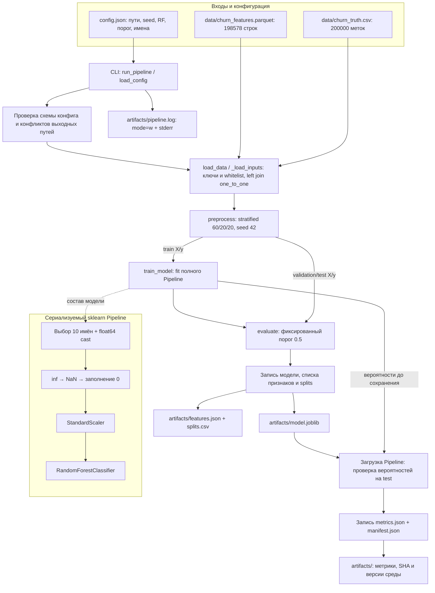

# Архитектура конвейера

[Интерактивная standalone-схема](<architecture.html>) создана archify по committed-коду `49314d8068005fb70fddf411741f77e72bb81651`. Содержание русское; элементы интерфейса viewer используют английский fallback. Автоматические validation/delivery/check/browser-check пройдены; perceptual visual review не выполнялся. Вспомогательные candidate/receipts остаются в игнорируемом scratch, не входят в публичную поставку. URL в metadata — identity публичного репозитория; сами metadata не являются доказательством публикации.

## Слои и потоки

Это один batch-процесс, а не набор сетевых сервисов. [pipeline.py](<pipeline.py>) управляет последовательными этапами; [config.json](<config.json>) определяет пути/параметры. Mermaid ниже разворачивает тот же путь подробнее: модель сначала сохраняется и загружается для проверки, затем фиксируются метрики и manifest.

## Ответственность и источники

| Слой | Реальная ответственность | Источник |
|---|---|---|
| Управление | Валидация JSON, разрешение путей относительно конфига, запрет совпадений/alias входов и выходов до открытия лога | [pipeline.py:250–333](<pipeline.py#L250-L333>) |
| Данные | Parquet/CSV, уникальные непустые ключи, числовой whitelist, полное покрытие признаков метками, сохранение порядка строк | [pipeline.py:354–455](<pipeline.py#L354-L455>) |
| Разбиение | Два стратифицированных split, сырые X без обучения преобразований, таблица ключей | [pipeline.py:463–536](<pipeline.py#L463-L536>) |
| Обучение | Стандартные сериализуемые transformers; fit только на train | [pipeline.py:544–613](<pipeline.py#L544-L613>) |
| Оценка | val/test, ROC-AUC и threshold-метрики; однопоточная агрегация вероятностей для детерминизма | [pipeline.py:589–639](<pipeline.py#L589-L639>) |
| Хранение | log/stderr, per-file atomic writes, reload и manifest | [pipeline.py:647–846](<pipeline.py#L647-L846>) |
| Упаковка | Python 3.11, pinned зависимости, `/app`, bundled data, CLI CMD | [Dockerfile](<Dockerfile>), [requirements.txt](<requirements.txt>) |

HTML — обзор функциональных этапов: стрелки не обозначают отдельные процессы или транзакционную границу; `run_pipeline` вызывает этапы и является владельцем записи/reload. Детализация фактического порядка сохранения находится в Mermaid и [run_pipeline](<pipeline.py#L779-L846>).

## Границы хранения и исполнения

- Входы неизменяемы в ходе запуска: [признаки](<data/churn_features.parquet>) и [эталон](<data/churn_truth.csv>). Из эталона передаётся только `churned`; идентификатор нужен для join/splits, не модели. 1 422 строки эталона без признаков не обучают модель.
- Локально результаты пишутся в `artifacts/` относительно каталога конфига. Имена описаны в [README](<README.md#артефакты>) и [config.json](<config.json#L41-L52>).
- В Docker входы и код находятся в `/app`, а результаты `/app/artifacts` вынесены bind mount в host-каталог. Подробная команда — [README](<README.md#docker>). Контейнер не требует внешней БД, сети при обучении или GPU; сеть нужна при первичной сборке для получения dependencies.
- `model.joblib` хранит весь preprocessing и модель. JSON/CSV доступны независимо; загружать joblib можно только из доверенного источника.
- Замена атомарна для каждого файла, но не для всего набора; rollback, concurrent writers и кеш отсутствуют. Каждый повторный запуск заново обучает и перезаписывает стабильные имена, log открывается с `mode=w`.

## Граница научной интерпретации

Схема сохраняет ретроспективную задачу исходного notebook 6.1 + HW5, а не создаёт будущий `churn_30d`. Окно признаков может содержать последствия ухода. Train-only fit защищает от межвыборочного обучения преобразований, **не** устраняет temporal hindsight. Для честного будущего прогноза нужны иная целевая временная область, исторические срезы и out-of-time оценка — [протокол](<docs/evaluation_protocol.md>).
